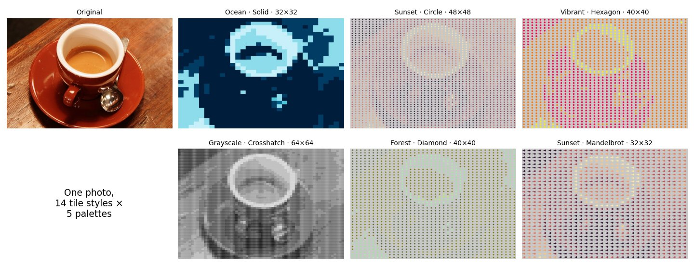

# Image Mosaic Generator

Turn any photo into a mosaic of patterned tiles, with **14 tile styles** (from solid squares to Mandelbrot fractals) and **5 color palettes**. It comes with an interactive Gradio app, quality metrics (MSE, SSIM, PSNR), and a benchmark showing the vectorized NumPy pipeline running **up to 16.7× faster** than a loop-based version.



## How it works

```
photo ──► crop to an N×N grid ──► average color per cell ──► nearest palette color ──► draw a tile per cell ──► mosaic
                (N = 8…128)          (one reshape + mean)       (vectorized distances)      (14 styles)
```

1. **Grid division.** The image is cropped to fit an N×N grid. All cell averages are computed at once with a single reshape, with no Python loop:
   ```python
   tile_colors = image.reshape(N, tile_h, N, tile_w, 3).mean(axis=(1, 3))
   ```
2. **Color quantization.** Each cell color is mapped to the nearest palette color by Euclidean distance in RGB. Distances between every cell and every palette color are computed in one broadcast.
3. **Tile generation.** One tile is pre-rendered per palette color in the chosen style, so drawing is a lookup rather than redrawing each cell.
4. **Assembly and scoring.** Tiles are placed by index. MSE, SSIM and PSNR are then computed against the cropped original.

**Tile styles:** Solid, Gradient, Striped, Circle, Diamond, Triangle, Crosshatch, Noise, Hexagon, Fibonacci, Golden Ratio, Mandelbrot, Emoji, Rhombus.
**Palettes:** Grayscale, Ocean, Vibrant, Sunset, Forest.

## Results

**Quality** for the gallery above (1:1 grayscale comparison with the original):

| Palette · style · grid | MSE ↓ | SSIM ↑ | PSNR ↑ |
|---|---|---|---|
| Ocean · Solid · 32×32 | 3,644 | 0.386 | 12.5 dB |
| Grayscale · Crosshatch · 64×64 | 4,560 | 0.076 | 11.5 dB |
| Vibrant · Hexagon · 40×40 | 10,417 | 0.132 | 8.0 dB |
| Sunset · Mandelbrot · 32×32 | 10,623 | 0.127 | 7.9 dB |
| Sunset · Circle · 48×48 | 11,049 | 0.114 | 7.7 dB |
| Forest · Diamond · 40×40 | 11,363 | 0.167 | 7.6 dB |

Solid tiles score best because every pixel carries the cell's color. Patterned tiles trade fidelity for texture: their light backgrounds lower brightness similarity even when the image stays recognisable.

**Speed.** Grid division only, on the 400×600 example photo, on a laptop CPU:

| Grid | Vectorized | Loop-based | Speedup |
|---|---|---|---|
| 8×8 | 1.6 ms | 1.9 ms | 1.2× |
| 32×32 | 1.7 ms | 5.1 ms | 3.0× |
| 64×64 | 2.0 ms | 14.8 ms | 7.3× |
| 128×128 | 2.6 ms | 43.6 ms | **16.7×** |

Both versions are O(N²), but the vectorized one stays almost flat because the work runs in NumPy's C code instead of the Python interpreter. The app's **Performance** tab runs this benchmark on any uploaded image and plots it. A full write-up is in [`MosaicGeneratorReport.pdf`](MosaicGeneratorReport.pdf).

## Run it

```bash
git clone https://github.com/Rhea-Thomas/Mosaic-Generator.git
cd Mosaic-Generator
python -m venv .venv && source .venv/bin/activate   # Windows: .venv\Scripts\activate
pip install -r requirements.txt
python app.py        # opens the Gradio app at http://127.0.0.1:7860
```

Upload an image, choose a grid size, palette and tile style, and click **Generate**. The app shows the original, the color-quantized grid, and the final mosaic side by side, with metrics.

## Project structure

```
Mosaic-Generator/
├── app.py                     # Pipeline, 14 tile generators, metrics, benchmark, Gradio UI
├── requirements.txt
├── MosaicGeneratorReport.pdf  # Design and performance report
└── examples/                  # Gallery images used in this README
```

## Credits

Example photo: `coffee` from [scikit-image's sample data](https://scikit-image.org/docs/stable/api/skimage.data.html#skimage.data.coffee), courtesy of Pikolo Espresso Bar (CC0).
